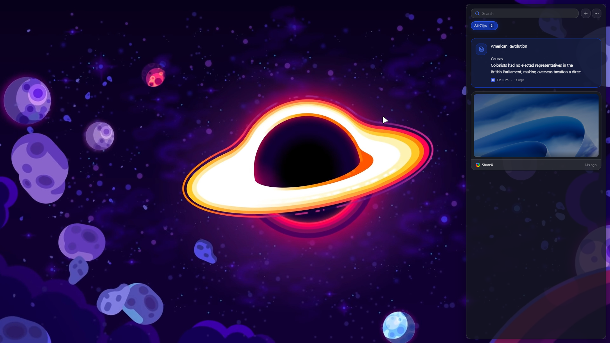
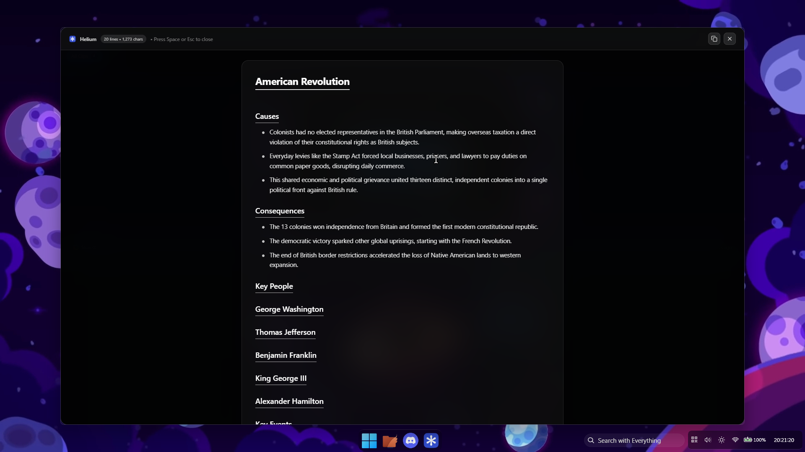
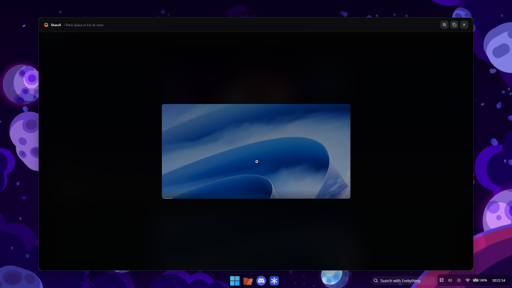

<h1 align="center">
  
   
  PastePaw &mdash; Right-Edge Sidebar Fork
</h1>

  A customized Windows fork of <a href="../releases">PastePaw</a> (v1.6.0) featuring a <code>440px</code> frosted-glass vertical sidebar along the right edge of the screen, an Egyptian Blue (<code>#1434A4</code>) accent theme, and a Spacebar Quick Look preview for images, code, and formatted notes.

<h2>Screenshots</h2>
<table>
  <tr>
    <th align="center">Floating Right-Edge Sidebar</th>
    <th align="center">Spacebar Quick Look (Formatted Notes)</th>
    <th align="center">Spacebar Quick Look (Images)</th>
  </tr>
  <tr>
    <td align="center"></td>
    <td align="center"></td>
    <td align="center"></td>
  </tr>
</table>

<h2>Changes from Upstream</h2>

<h3>Window &amp; Sidebar Layout (<code>src-tauri/src/lib.rs</code>, <code>frontend/src/App.tsx</code>)</h3>
<ul>
  <li>Replaced the wide bottom dock geometry in <code>animate_window_show</code>, <code>animate_window_hide</code>, and <code>update_window_size</code> with a <code>440px</code>-wide floating vertical sidebar anchored to the right edge of the active monitor.</li>
  <li>Applied frosted-glass container styling (<code>rounded-2xl</code>, subtle border highlight, drop shadow, and <code>backdrop-blur-2xl</code>) to the main application shell.</li>
</ul>

<h3>Theme &amp; Header (<code>frontend/src/components/ControlBar.tsx</code>)</h3>
<ul>
  <li>Redesigned the control bar for a narrow vertical layout with a persistent search bar at the top, quick-action buttons (<code>+</code> and Settings) on the right, and wrapped pill-shaped category tabs underneath.</li>
  <li>Standardized the accent palette around Egyptian Blue (<code>#1434A4</code>).</li>
</ul>

<h3>Clip Cards (<code>frontend/src/components/ClipCard.tsx</code>)</h3>
<ul>
  <li><b>Images:</b> Render as full-width visual cards (<code>max-h-96 w-full object-contain</code>) without hover cropping or zoom distortion, paired with a frosted footer displaying the source application icon, app name, and relative timestamp.</li>
  <li><b>Text, Code &amp; URLs:</b> Render as multi-line cards (<code>whitespace-pre-wrap line-clamp-5</code>) with <code>#1434A4</code> / <code>#4d79ff</code> type badges, frosted hover states, and a one-click copy button.</li>
</ul>

<h3>Spacebar Quick Look (<code>src-tauri/src/lib.rs</code>, <code>frontend/src/components/ClipList.tsx</code>)</h3>
<ul>
  <li>Added a <code>set_preview_mode</code> Tauri command that expands the window to <code>85% &times; 88%</code> centered on screen when pressing <kbd>Spacebar</kbd> on a hovered or selected clip, and restores the <code>440px</code> right sidebar when closed.</li>
  <li>Added <code>FormattedNoteView</code> to reconstruct underlined headings, section headers, and indented bullet/numbered lists when previewing copied notes or documents, alongside full-text detail fetching.</li>
</ul>

<h3>Build Configuration (<code>src-tauri/tauri.conf.json</code>)</h3>
<ul>
  <li>Set <code>"createUpdaterArtifacts": false</code> under <code>"bundle"</code> so standalone Windows NSIS (<code>.exe</code>) and MSI installers can be built locally without the upstream signing key.</li>
</ul>

<h2>Dependencies</h2>

<h3>Backend &amp; Desktop Runtime</h3>
<ul>
  <li><b>Tauri v2 (<code>2.10.x</code>):</b> Rust desktop shell, global hotkeys, window management, and NSIS/MSI bundler.</li>
  <li><b>Rust (Edition 2021):</b> Native backend commands, SQLite history storage, and window geometry logic.</li>
</ul>

<h3>Frontend</h3>
<ul>
  <li><b>React (<code>18.3.1</code>) &amp; TypeScript (<code>5.9.3</code>):</b> Component architecture and static type safety.</li>
  <li><b>Vite (<code>5.4.21</code>):</b> Frontend build tool and asset bundler.</li>
  <li><b>Tailwind CSS (<code>3.4.19</code>) &amp; <code>@tailwindcss/typography</code>:</b> Layout styling and formatted note typography.</li>
  <li><b>Framer Motion (<code>12.38.0</code>):</b> Sidebar and preview transitions.</li>
  <li><b>Lucide React (<code>0.294.0</code>):</b> Vector UI icons.</li>
  <li><b>React Window (<code>2.2.5</code>):</b> Virtualized list scrolling.</li>
  <li><b>React Markdown (<code>10.1.0</code>):</b> Markdown preview rendering.</li>
  <li><b>i18next (<code>23.16.8</code>) &amp; <code>react-i18next</code> (<code>14.1.3</code>):</b> Multi-language localization.</li>
  <li><b>Utilities:</b> <code>date-fns</code> (<code>2.30.0</code>), <code>clsx</code>, <code>tailwind-merge</code>, <code>sonner</code>, <code>use-shortcut-recorder</code>.</li>
</ul>

<h3>Tauri Plugins</h3>
<ul>
  <li><code>@tauri-apps/api</code> (<code>2.10.1</code>)</li>
  <li><code>@tauri-apps/plugin-clipboard-manager</code> (<code>2.3.2</code>)</li>
  <li><code>@tauri-apps/plugin-log</code> (<code>2.8.0</code>)</li>
  <li><code>@tauri-apps/plugin-opener</code> (<code>2.5.3</code>)</li>
  <li><code>@tauri-apps/plugin-process</code> (<code>2.3.1</code>)</li>
  <li><code>@tauri-apps/plugin-updater</code> (<code>2.10.0</code>)</li>
</ul>

<h2>Installation &amp; Shortcuts</h2>
<ol>
  <li>Download <code>PastePaw_1.6.0_x64-setup.exe</code> (or <code>.msi</code>) from the <a href="../releases">Releases</a> page and run the installer.</li>
  <li>Press <kbd>Ctrl</kbd> + <kbd>Shift</kbd> + <kbd>V</kbd> (or <kbd>Win</kbd> + <kbd>V</kbd> if remapped via Windows PowerToys) to toggle the right-edge sidebar.</li>
  <li>Hover over or select any clip and press <kbd>Spacebar</kbd> to open or close the centered Quick Look preview.</li>
</ol>

<h2>Building from Source</h2>

Requires Node.js (v18+) and Rust (MSVC toolchain on Windows):

<pre><code>npm install
npx tauri build -c "{\"build\":{\"beforeBuildCommand\":\"npm run build\"}}"</code></pre>

Installers are generated in <code>src-tauri\target\release\bundle\nsis\</code> and <code>src-tauri\target\release\bundle\msi\</code>.

<h2>Credits</h2>
<ul>
  <li><b>Upstream Project:</b> <a href="https://github.com">PastePaw</a> by <a href="https://github.com">@XueshiQiao</a></li>
  <li><b>Fork Modifications:</b> <a href="https://github.com">@ahmeto55</a> (developed with assistance from Google Gemini)</li>
</ul>
